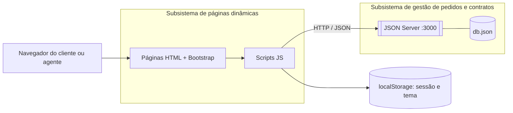
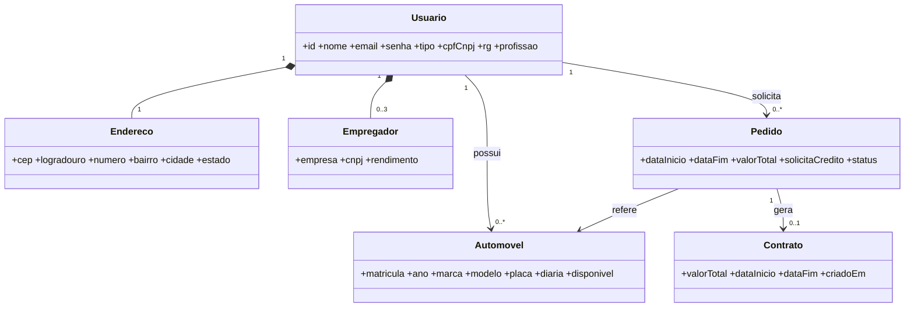

<!-- README baseado no template do Prof. Dr. João Paulo Aramuni -->
🚗 CARent — Sistema de Aluguel de Carros 👨‍💻

[!NOTE] Plataforma web para solicitar, acompanhar e contratar aluguéis de automóveis com análise financeira feita por locadoras e bancos, incluindo crédito associado ao aluguel.

<table> <tr> <td width="800px"> <div align="justify"> O <b>CARent</b> é um sistema de apoio à gestão de aluguéis de automóveis desenvolvido para o <b>Laboratório 02</b> da disciplina de <i>Desenvolvimento de Interfaces Web (DIW)</i>, do curso de Engenharia de Software da PUC Minas. Clientes cadastrados podem <b>criar, modificar, consultar e cancelar pedidos</b> de aluguel, enquanto os agentes (<b>locadoras e bancos</b>) <b>avaliam, modificam e transformam em contrato</b> os pedidos aprovados. O sistema é construído com <b>HTML5, CSS3 e JavaScript</b>, interface em <b>Bootstrap 5</b> e persistência em uma API REST simulada com <b>JSON Server</b>, consumida via <b>Fetch API</b>. </div> </td> <td> <div>  </div> </td> </tr> </table>

---

## 🚧 Status do Projeto

     

---

## 📚 Índice
- [Links Úteis](#-links-úteis)
- [Sobre o Projeto](#-sobre-o-projeto)
- [Funcionalidades Principais](#-funcionalidades-principais)
- [Tecnologias Utilizadas](#-tecnologias-utilizadas)
- [Arquitetura](#-arquitetura)
- [Instalação e Execução](#-instalação-e-execução)
- [Deploy](#-deploy)
- [Estrutura de Pastas](#-estrutura-de-pastas)
- [Demonstração](#-demonstração)
- [Testes](#-testes)
- [Documentações utilizadas](#-documentações-utilizadas)
- [Autores](#-autores)
- [Contribuição](#-contribuição)
- [Agradecimentos](#-agradecimentos)
- [Licença](#-licença)

---

## 🔗 Links Úteis
* 📖 **Diagramas UML:** [Casos de uso, classes, pacotes e componentes](./docs/diagramas.md)
  > 📚 **Descrição:** Modelos do sistema em Mermaid, renderizados direto no GitHub.
* 🌐 **Demo Online:** _não publicada_ (o sistema depende do JSON Server rodando localmente).

---

## 📝 Sobre o Projeto
O processo de aluguel de carros costuma envolver várias etapas manuais: o cliente pede, a locadora confere os dados, um banco analisa a renda e, só então, o contrato é fechado. O **CARent** reúne esse fluxo em um único sistema web.

- **Por que existe:** atender ao Laboratório 02 de DIW, que pede um protótipo de sistema de aluguel de carros com CRUD de cliente e pedidos.
- **Problema que resolve:** centraliza o pedido, a análise financeira e a execução do contrato, com o status visível para cliente e agente.
- **Contexto:** acadêmico (PUC Minas — Engenharia de Software, 2º período).
- **Onde pode ser usado:** locadoras e bancos que concedem crédito para aluguel, em cenário simulado.

O cliente informa dados de identificação (RG, CPF, nome, endereço), profissão e até **3 entidades empregadoras** com os respectivos rendimentos. O aluguel pode estar associado a um **contrato de crédito concedido por um banco**.

---

## ✨ Funcionalidades Principais

- 🔐 **Autenticação:** cadastro de Cliente, Locador e Banco, login, logout e proteção das páginas internas.
- ⚙️ **CRUD de cliente:** consultar, editar e excluir a própria conta (`perfil.html`), com até 3 empregadores.
- 🚘 **Catálogo de veículos:** matrícula, ano, marca, modelo, placa, diária, foto e proprietário (locadora, banco ou cliente), com filtros.
- 📝 **Pedido de aluguel:** datas, cálculo automático do total e opção de solicitar crédito.
- 🔄 **Gestão de pedidos:** o cliente modifica e cancela; o agente analisa, aprova, rejeita e modifica.
- 🏦 **Crédito:** o banco que aprova um pedido com crédito solicitado fica registrado como concedente.
- 📄 **Contrato:** o agente executa o contrato de um pedido aprovado, e o veículo deixa de aparecer como disponível.
- 🌗 **Tema claro/escuro** e layout responsivo.

### Fluxo de status do pedido
`Pendente → Em análise → Aprovado → Contratado` (ou `Rejeitado` / `Cancelado`)

---

## 🛠 Tecnologias Utilizadas

### 💻 Front-end
* **Estrutura e lógica:** HTML5, CSS3 e JavaScript (ES6+)
* **Interface:** Bootstrap 5.3.3 (via CDN)
* **Estilização:** CSS próprio (`login.css`) com variáveis para tema claro/escuro
* **Gerenciamento de estado:** `localStorage` (sessão e tema)

### 🖥️ API e persistência
* **API:** JSON Server (API REST simulada), consumida via **Fetch API**
* **Banco de dados:** arquivo `db.json` (`usuarios`, `automoveis`, `pedidos`, `contratos`)

### ⚙️ Ferramentas
* **Runtime:** Node.js (apenas para o JSON Server)
* **IDE:** VS Code com a extensão Live Server
* **Versionamento:** Git e GitHub

---

## 🏗 Arquitetura

O sistema é dividido em **dois subsistemas**, conforme o enunciado: um para **gestão de pedidos e contratos** (API + `db.json`) e outro para a **construção dinâmica das páginas web** (HTML + JavaScript no navegador). O servidor central se comunica com os clientes e com os agentes pela Internet via requisições HTTP/JSON.

- **Camada de apresentação:** páginas HTML com Bootstrap.
- **Camada de lógica:** `site.js` (sessão, tema, login, cadastro) e um script por página (`veiculos.js`, `pedidos.js`, `perfil.js`).
- **Camada de dados:** JSON Server expondo `/usuarios`, `/automoveis`, `/pedidos` e `/contratos`.
- **Decisão importante:** a sessão fica no `localStorage`, e o controle de acesso é feito no front-end (escopo de laboratório).

### Diagrama de componentes


### Diagrama de classes (resumo)


> Os diagramas completos (casos de uso, classes, pacotes e componentes) estão em [`docs/diagramas.md`](./docs/diagramas.md).

---

## 🔧 Instalação e Execução

### Pré-requisitos
* **Node.js:** versão LTS (v18 ou superior)
* **VS Code** com a extensão **Live Server** (ou outro servidor estático)
* **Git**

### 📦 Instalação
```bash
git clone <URL_DO_SEU_REPOSITÓRIO>
cd <pasta-do-projeto>
```
Não há dependências para instalar: o Bootstrap é carregado por CDN (é necessário internet) e o JSON Server roda via `npx`.

### ⚡ Como Executar
Use **dois terminais/processos**.

**1. API (JSON Server):**
```bash
npx json-server --watch db.json --port 3000
```
🚀 *A API estará em **http://localhost:3000**.*

**2. Front-end:** abra o `index.html` com o **Live Server** (botão direito → *Open with Live Server*).
🎨 *O site estará em **http://127.0.0.1:5500**.*

### 👤 Usuários de teste (senha `123456`)
| Tipo | E-mail |
| :--- | :--- |
| Cliente | `cliente@teste.com` |
| Banco | `banco@teste.com` |
| Locador | `locadora@teste.com` |

> 💡 O site guarda um usuário logado por vez. Para testar cliente e agente juntos, use uma janela normal e uma **janela anônima**.

---

## 🚀 Deploy
O projeto é um protótipo acadêmico e roda localmente. Por depender do JSON Server, uma publicação exigiria hospedar também a API (por exemplo, em um serviço Node.js). Os arquivos estáticos podem ser servidos pelo **GitHub Pages**, mas sem a API o sistema não funciona.

---

## 📂 Estrutura de Pastas

```
.
├── index.html            # 🏠 Página inicial
├── login.html            # 🔐 Login
├── cadastro.html         # 📝 Cadastro (cliente, locador, banco)
├── veiculos.html         # 🚘 Catálogo e criação de pedido
├── pedidos.html          # 📋 Gestão de pedidos (cliente e agente)
├── perfil.html           # 👤 CRUD de cliente
├── site.js               # 🔧 Tema, sessão, login e cadastro
├── veiculos.js           # 🔧 Lógica do catálogo
├── pedidos.js            # 🔧 Lógica dos pedidos e contratos
├── perfil.js             # 🔧 Lógica do perfil
├── login.css             # 🎨 Estilos
├── db.json               # 💾 Banco do JSON Server
├── README.md             # 📘 Documentação principal
```

---

## 🎥 Demonstração

Adicione aqui os prints do sistema (de preferência hospedados no repositório, em `docs/prints/`).

| Tela | Captura de Tela |
  
  
| **Página Inicial** | **Login** |
 
 
| **Cadastro** | **Catálogo de Veículos** |
  

  


| **Pedidos (cliente)** | **Pedidos (agente)** |
  

  

 
| **Perfil (CRUD de cliente)** | **Contrato gerado** |
 

 

 


### 💻 Exemplo de saída da API
```bash
curl http://localhost:3000/automoveis
```
```json
[
  {
    "id": "1",
    "matricula": "MAT-0001",
    "ano": 2022,
    "marca": "Porsche",
    "modelo": "911 Carrera",
    "placa": "ABC1D23",
    "imagem": "img/carro1.jpg",
    "diaria": 900,
    "disponivel": true
  }
]
```

---

## 🧪 Testes

O projeto não possui testes automatizados. A validação foi feita manualmente com o roteiro abaixo.

| # | Cenário | Resultado esperado |
| :-: | :--- | :--- |
| 1 | Cadastrar cliente, locador e banco | Conta criada e redirecionamento para o login |
| 2 | Cadastrar e-mail já existente | Mensagem de e-mail duplicado |
| 3 | Login com senha errada | Mensagem de erro |
| 4 | Acessar `veiculos.html` sem login | Redirecionamento para o login |
| 5 | Cliente cria pedido com crédito | Pedido salvo como `Pendente` |
| 6 | Cliente edita datas de pedido pendente | Total recalculado |
| 7 | Cliente cancela pedido | Status `Cancelado` |
| 8 | Banco analisa e aprova pedido com crédito | Banco registrado como concedente |
| 9 | Agente executa contrato | Contrato em `/contratos`, pedido `Contratado`, carro indisponível |
| 10 | Cliente edita e exclui a própria conta | Dados atualizados; exclusão bloqueada se houver pedido em andamento |

---

## 🔗 Documentações utilizadas

* 📖 **Interface:** [Bootstrap 5](https://getbootstrap.com/docs/5.3/getting-started/introduction/)
* 📖 **API:** [JSON Server](https://github.com/typicode/json-server)
* 📖 **Requisições:** [Fetch API (MDN)](https://developer.mozilla.org/pt-BR/docs/Web/API/Fetch_API)
* 📖 **Modelagem:** [Diagrama de Pacotes](https://www.uml-diagrams.org/package-diagrams.html) e [Mermaid](https://mermaid.js.org/)
* 📖 **Guia de Estilo:** [Conventional Commits](https://www.conventionalcommits.org/en/v1.0.0/)

---

## 👥 Autores

 👤 Nome: Susana Oliveira e Telles

---


## 🙏 Agradecimentos

* [**Engenharia de Software PUC Minas**](https://www.instagram.com/engsoftwarepucminas/) — Pelo apoio institucional e estrutura acadêmica.
* [**Prof. Dr. João Paulo Aramuni**](https://github.com/joaopauloaramuni) — Pelo conteúdo e orientação da disciplina de Desenvolvimento de Interfaces Web.

---

## 📄 Licença

Este projeto é distribuído sob a **Licença MIT**. Projeto acadêmico, sem fins comerciais.

---
